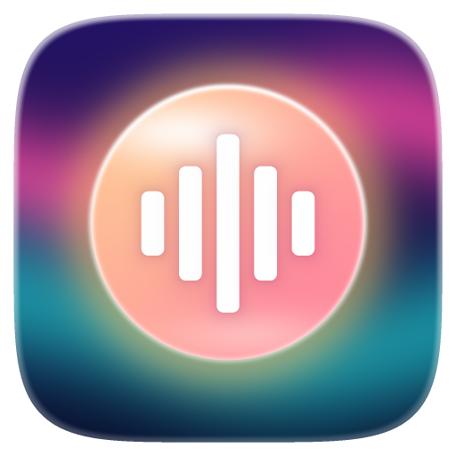
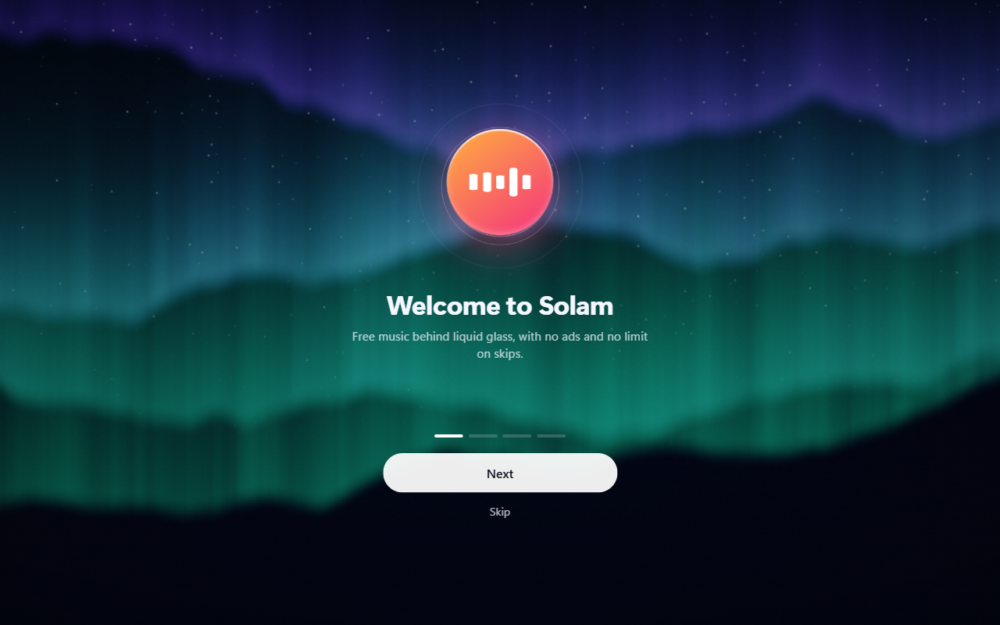
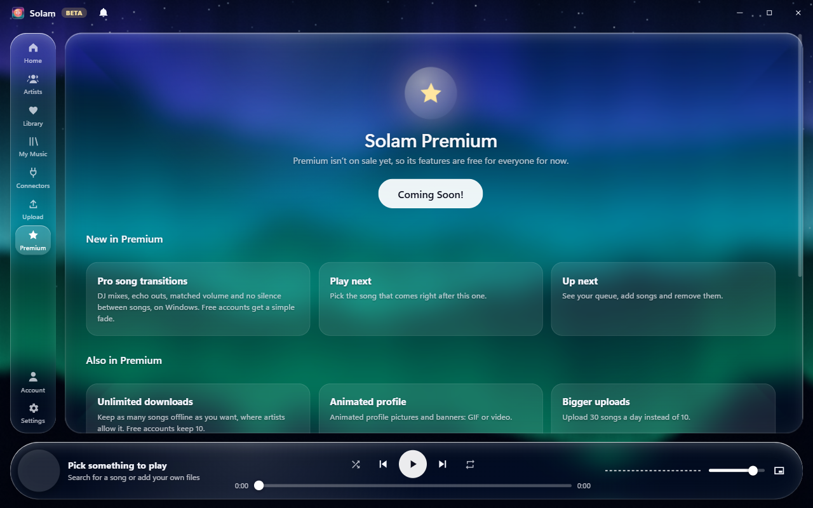

  

<h1 align="center">Solam</h1>

<strong>A free music app with no ads and a liquid glass look.</strong> For Windows, iPhone and Android. Beta version.

  <a href="https://github.com/v1sion0coder/solam/releases/latest/download/Solam-Setup.exe"><strong>Download for Windows</strong></a> ·
  <a href="https://v1sion0coder.github.io/solam/app/"><strong>Open on iPhone or Android</strong></a> ·
  <a href="https://v1sion0coder.github.io/solam/"><strong>Website</strong></a>

  

## What's inside

- **Free music:** songs from independent artists, plus free albums from netlabels whose licenses let anyone share them
- **Famous artists:** 30-second previews, with a button to hear the full song on a licensed service
- **Liquid glass:** animated themes, and glass you can set from clear to tinted
- **Lyrics:** lines light up along with the song when timed lyrics exist
- **Playing:** repeat, shuffle, Up next, a mini player, a sleep timer, and offline songs where artists allow it
- **For artists:** free uploads, a place on Home, listener numbers, and your own profile
- **With friends:** comments, shared playlists, and song links with QR codes
- **Languages:** English, Russian, Spanish, Portuguese and German

  

## Install

**Windows 10 and 11:** [download the installer](https://github.com/v1sion0coder/solam/releases/latest/download/Solam-Setup.exe). Windows warns about new apps without a paid signature, so click **More info**, then **Run anyway**. Updates install themselves after that.

**iPhone:** open the [Solam app page](https://v1sion0coder.github.io/solam/app/) in Safari, tap **Share**, then **Add to Home Screen**.

**Android:** open the [Solam app page](https://v1sion0coder.github.io/solam/app/) in Chrome, tap **⋮**, then **Add to Home screen** or **Install app**.

## About the music

Solam doesn't host pirated music. Free albums come from netlabels on the Internet Archive under Creative Commons or public domain terms, and each shows its license. Albums by well-known artists are filtered out, but licenses are set by uploaders, so reports are always welcome. If a song uses your work without permission, open its … menu and choose **Report this song**, then **Report for copyright**.

## Help

- Use **Contact support** inside Solam, or write to salam0support@gmail.com
- [Terms](https://v1sion0coder.github.io/solam/terms.html) and [Privacy](https://v1sion0coder.github.io/solam/privacy.html)

This repository holds the website, the phone version and the releases.
